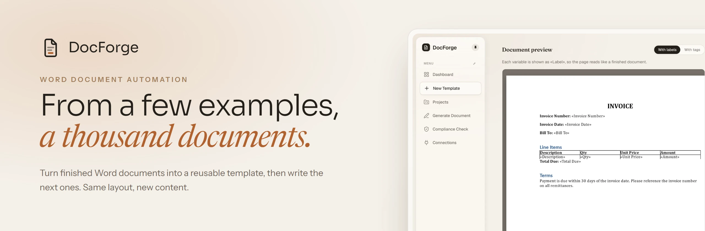
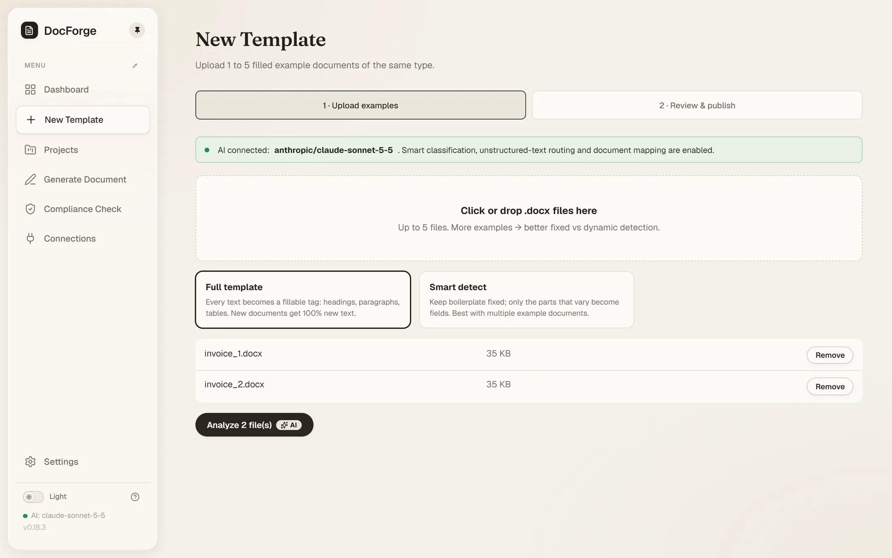
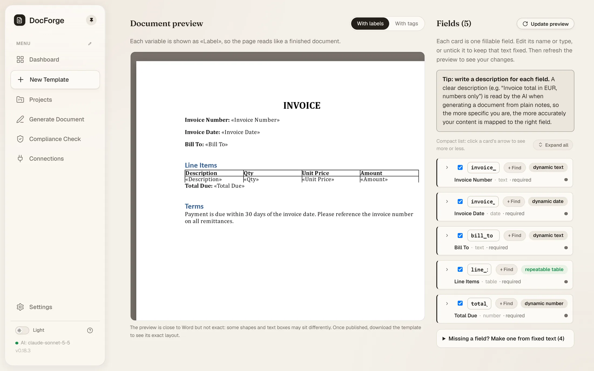
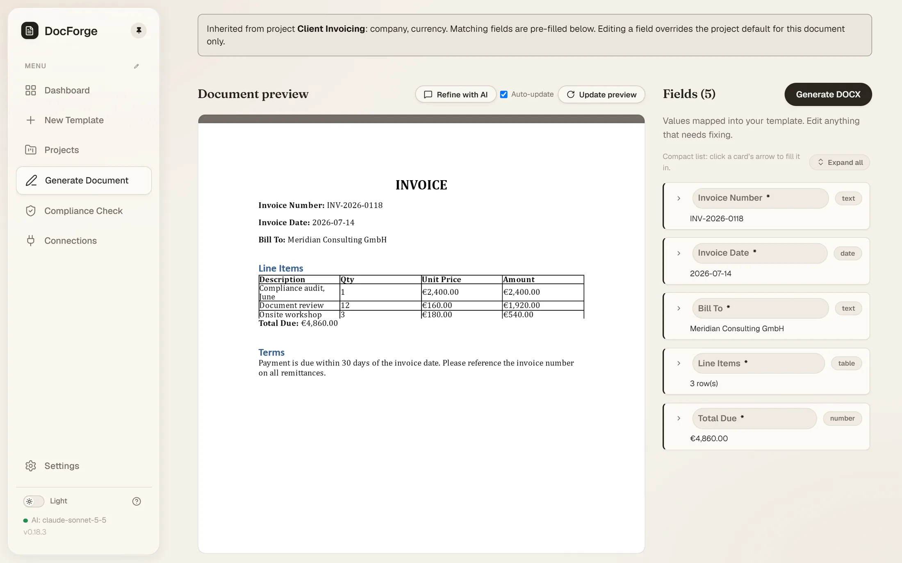
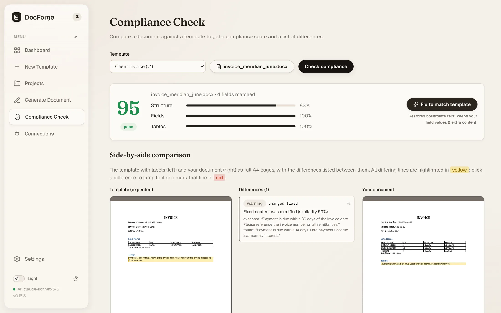

<p align="center">
  <a href="https://www.docforge.live">
    <picture>
      <source media="(prefers-color-scheme: dark)" srcset="docs/images/banner-dark.webp">
      
    </picture>
  </a>
</p>

<p align="center">
  <a href="https://www.docforge.live"><b>Website</b></a>
  &nbsp;·&nbsp;
  <a href="https://app.docforge.live"><b>Try the app</b></a>
  &nbsp;·&nbsp;
  <a href="https://www.docforge.live/tutorials/"><b>Tutorial</b></a>
  &nbsp;·&nbsp;
  <a href="#run-it-on-your-computer"><b>Run it on your computer</b></a>
</p>

<p align="center">
  
  
  
  
  
</p>

DocForge turns finished Word documents into reusable templates. Upload one to
five `.docx` files of the same kind, and it works out what stays fixed, what
changes and what repeats. Fonts, tables, headers and numbering stay exactly as
they were, because DocForge edits the Word file itself instead of redrawing it.
Then fill the template from a form, rough notes, another document or JSON, and
download a finished `.docx` in the same layout. When a document comes back
edited, DocForge checks it against its template and can put it back in shape.

DocForge is a free, open-source prototype under the [MIT License](LICENSE).

## How it works

<table>
  <tr>
    <td width="50%" valign="top">
      <picture>
        <source media="(prefers-color-scheme: dark)" srcset="docs/images/new-template-upload-dark.webp">
        
      </picture>
      <p><b>1. Upload examples.</b> One to five finished documents of the same kind. Pick <b>Full template</b> to make every text fillable, or <b>Smart detect</b> to keep boilerplate fixed.</p>
    </td>
    <td width="50%" valign="top">
      <picture>
        <source media="(prefers-color-scheme: dark)" srcset="docs/images/template-review-dark.webp">
        
      </picture>
      <p><b>2. Review, then publish.</b> Every field sits next to a live Word preview. Rename it, change its type, untick it, or turn fixed text into a field. Publishing makes version 1.</p>
    </td>
  </tr>
  <tr>
    <td width="50%" valign="top">
      <picture>
        <source media="(prefers-color-scheme: dark)" srcset="docs/images/generate-form-dark.webp">
        
      </picture>
      <p><b>3. Generate.</b> Fill the form, paste notes, upload a filled document or send JSON. The AI puts each piece of content in the right field. Repeating table rows are added per item.</p>
    </td>
    <td width="50%" valign="top">
      <picture>
        <source media="(prefers-color-scheme: dark)" srcset="docs/images/compliance-dark.webp">
        
      </picture>
      <p><b>4. Check compliance.</b> Compare an edited document with its template: a score, every difference highlighted side by side, and a one-click fix.</p>
    </td>
  </tr>
</table>

**Also in the box**

- **Projects.** Group templates by client or team. Metadata set once on the project fills matching fields.
- **Versions.** Every publish is a new version that never changes. Source documents and history stay on the template.
- **Two downloads per template.** *With labels* reads like a finished document; *with tags* is a [docxtpl](https://docxtpl.readthedocs.io) template you can use in other tools.
- **A table of contents that follows its headings.** Each entry shows its heading's tag, and Word offers to refresh the page numbers when the document opens.
- **Costs you can see.** Tokens and estimated cost on every AI action, plus lifetime totals in Settings.

## AI, or none

| Mode | What happens |
|---|---|
| **No AI** | A deterministic engine compares your examples and fills templates. Nothing leaves your server. |
| **Free AI actions** | On [app.docforge.live](https://app.docforge.live), every account gets 10, on Claude Haiku 5.5. |
| **Your own key** | Anthropic (Claude, recommended), OpenAI, Google Gemini, DeepSeek, OpenRouter, or any OpenAI-compatible server such as Ollama or LM Studio. Keys are stored on the server and never sent back to the browser. |

With AI on, each step reads the whole document before it decides anything, can
look up evidence with tools (an element's full text, its neighbours, how it
differs across your examples), and a second pass reviews the result. If a call
fails, that step falls back to the deterministic engine, so a missing or broken
key never breaks the app.

## Try it

The hosted prototype at **[app.docforge.live](https://app.docforge.live)** is
free. It is for trying DocForge out, so please don't upload confidential
documents. For real documents, run it on your own computer.

## Run it on your computer

One user, no sign-in, and no AI key needed. You need Python 3.11+ and
Node.js 18+.

```bash
cd backend
python -m venv .venv
source .venv/bin/activate        # Windows: .venv\Scripts\activate
pip install -e ".[dev]"
cp ../.env.example .env          # local defaults: no sign-in, files on disk
docforge seed                    # optional: three demo templates
docforge serve                   # API on http://localhost:8000
```

```bash
cd frontend
npm install
npm run dev                      # app on http://localhost:3000
```

**With Docker**, the same single-user setup in two containers:

```bash
docker compose up --build        # app on http://localhost:3000
```

## Configuration

The easiest way to turn on AI is in the app: **Settings → LLM Settings**, then
**Use recommended setup** and paste your Anthropic key. Without a key, the
deterministic engine does the work.

The backend also reads `DOCFORGE_*` settings from `backend/.env`.
[`.env.example`](.env.example) lists them; these are the useful ones on your
computer:

| Variable | Default | What it does |
|---|---|---|
| `DOCFORGE_AI_ENABLED` / `_PROVIDER` / `_MODEL` / `_API_KEY` | off / `anthropic` / `claude-haiku-5-5` / none | A default AI key, instead of setting one in the app. |
| `DOCFORGE_DATA_DIR` | `./data` | Where the database, templates and documents are kept. |
| `DOCFORGE_GENERATED_RETENTION_DAYS` | `14` | Generated documents are deleted after this many days. |
| `DOCFORGE_MAX_UPLOAD_MB` | `25` | The largest `.docx` you can upload. |

## How it's built

```
 Next.js app ──── REST + Supabase token ────► FastAPI backend ──► Postgres or SQLite
 (frontend/)                                   (backend/)       └► Supabase Storage or disk

 analyze   read the .docx → compare the examples → classify each part → build the template
 generate  place the content → write and check values → fill the template → .docx
 comply    deterministic diff and score → optional AI note on what matters → fix
```

| Folder | What lives there |
|---|---|
| `backend/docforge/ooxml_extractor`, `structure_normalizer`, `multi_doc_differ` | Read Word files safely and line up the examples |
| `backend/docforge/ai_classifier`, `template_builder`, `template_registry` | Decide fixed vs variable content and build versioned templates |
| `backend/docforge/ai_router`, `assembler`, `validator` | Put content into fields, render the `.docx`, check the rules |
| `backend/docforge/compliance` | Score a returned document and fix it |
| `backend/docforge/ai` | The AI client, agent loop, prompts, tools and cost tracking |
| `backend/docforge/api`, `services`, `storage`, `db` | HTTP routes, orchestration, file storage, database |
| `frontend/app`, `components`, `lib` | Pages, UI and the API client |

The interactive API reference is at `/docs` on a running backend. A public,
key-based API for your own pipelines is planned.

## Development

```bash
cd backend
pytest -q                # unit and integration tests
ruff check docforge      # lint

cd ../frontend
npx tsc --noEmit         # type check
npm run build            # production build
```

The tests need no API key: AI paths run against stubbed model replies and the
deterministic fallback.

## Security and privacy

- Each account sees only its own templates, projects and documents.
- Sign-in is Supabase; the backend verifies every token.
- Uploads are checked for type and size, and guarded against zip bombs, path
  traversal and unsafe XML.
- AI keys are stored on the server and never returned to the browser. Document
  text is kept out of the logs.
- Generated documents are deleted within 14 days. Deleting an account removes
  all of its data.

Found a problem? Email [support@docforge.live](mailto:support@docforge.live).

## License

[MIT](LICENSE) © The DocForge Authors
